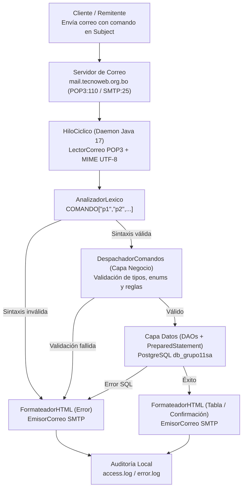

# INF513 · Proyecto #1 — Sistema de Analítica y Monitoreo Académico DEDTE vía Correo Electrónico

**Universidad Autónoma Gabriel René Moreno (UAGRM)**  
**Facultad de Ingeniería en Ciencias de la Computación y Telecomunicaciones (FICCT)**  
**Asignatura:** INF513 - Tecnología Web (Gestión 2026-2)  
**Docente:** Ing. Evans Balcazar Veizaga  
**Grupo:** `#11 SA` (`grupo11sa@tecnoweb.org.bo`)

## Integrantes
| Registro | Nombre Completo | Carrera |
| :--- | :--- | :--- |
| `221044434` | Duran Marcelo Kelly Alisson | Ing. en Informática |
| `219198322` | Quispe Delgado Julio Cesar | Ing. en Informática |

---

## 1. Arquitectura del Sistema (Email-Driven)



---

## 2. Flujo del Analizador Léxico (`AnalizadorLexico.java`)

```mermaid
flowchart LR
    S["Subject Raw"] --> M["Decodificación MIME UTF-8"]
    M --> P["Limpieza de prefijos Re:/Fwd:"]
    P --> C["Extracción de COMANDO"]
    C --> B["Verificación de '[' ... ']'"]
    B --> Q["Lectura de parámetros entre comillas<br/>con soporte de \\\" y \\\\"]
    Q --> V["Validación de separadores ',' y cierre ']'"]
    V --> R["Objeto Comando válido o Error descriptivo"]
```

---

## 3. Modelo de Base de Datos (PostgreSQL — `db_grupo11sa`)

El esquema en `sql/01_schema_dedte.sql` soporta los **8 Casos de Uso aprobados** y está diseñado para ser reutilizado directamente en el Proyecto #2 (Laravel + React):

* **CU1:** `usuarios`, `parametros_sistema` (umbrales de deserción y capacidad estándar)
* **CU2:** `entornos_moodle` (`VIRTUAL`, `PRESENCIAL`, `CAPACITACION`)
* **CU3:** `aulas_apertura` (facultad, carrera, sigla, grupo, docente, formato, estado)
* **CU4:** `monitoreo_academico` (inscritos, activos, aprobados, reprobados, promedio, densidad %)
* **CU5:** `evaluacion_riesgo` (retiros, moras, tasa de deserción, semáforo automático `VERDE` / `AMARILLO` / `ROJO`)
* **CU6:** Consulta consolidada de KPIs directivos (`DASHBOARD`)
* **CU7:** `historicos_semestrales` (comparativa entre gestiones)
* **CU8:** Reportes agregados por facultad (`REPFAC`) y entorno Moodle (`REPENT`)

---

## 4. Catálogo de Comandos (Asunto del Correo)

| CU | Comando | Ejemplo |
| :--- | :--- | :--- |
| Ayuda | `HELP["*"]` | `HELP["*"]` |
| CU1 | `LISUSU`, `INSUSU`, `MODUSU`, `DELUSU` | `INSUSU["4715292","Juan","Perez","DOCENTE","jp@uagrm.edu.bo","71055123"]` |
| CU1 | `LISPAR`, `INSPAR`, `MODPAR` | `MODPAR["UMBRAL_RIESGO_ROJO","25.0","Nuevo umbral crítico"]` |
| CU2 | `LISENT`, `INSENT`, `MODENT`, `DELENT` | `LISENT["VIRTUAL"]` |
| CU3 | `LISAPE`, `INSAPE`, `MODAPE`, `DELAPE` | `LISAPE["FICCT"]` |
| CU4 | `LISMON`, `INSMON`, `MODMON`, `DELMON` | `INSMON["1","60","55","49","6","76.5"]` |
| CU5 | `LISRIE`, `INSRIE`, `MODRIE`, `DELRIE` | `INSRIE["1","60","20","4","Alerta de abandono"]` |
| CU6 | `DASHBOARD` | `DASHBOARD["2026-2"]` |
| CU7 | `LISHIS`, `INSHIS`, `COMPHIS` | `COMPHIS["2025-2","2026-2"]` |
| CU8 | `REPFAC`, `REPENT` | `REPFAC["*"]` |

---

## 5. Instalación, Configuración y Ejecución (Windows y Fedora)

### Prerrequisitos
* **Java 17+** (`java -version`)
* **Maven 3.8+** (`mvn -version`) *(solo para compilar el `.jar`)*
* Acceso de red habilitado (IP whitelisted en `mail.tecnoweb.org.bo` puertos `5432`, `110`, `25`).

### Paso 1: Cargar el esquema en PostgreSQL
Ejecutar `sql/01_schema_dedte.sql` y `sql/02_seed_dedte.sql` sobre `db_grupo11sa`:
```bash
psql -h mail.tecnoweb.org.bo -p 5432 -U grupo11sa -d db_grupo11sa -f sql/01_schema_dedte.sql
psql -h mail.tecnoweb.org.bo -p 5432 -U grupo11sa -d db_grupo11sa -f sql/02_seed_dedte.sql
```

### Paso 2: Configurar credenciales
Editar `config.properties` en la raíz del proyecto con la contraseña asignada al grupo (`grupo11sa`).

### Paso 3: Compilar y ejecutar
```bash
mvn clean package
java -jar target/dedte-mail-system-1.0.0-jar-with-dependencies.jar
```

### Modos de verificación rápida
```bash
# Verificar solo conexión PostgreSQL
java -jar target/dedte-mail-system-1.0.0-jar-with-dependencies.jar --test-db

# Verificar el analizador léxico sin conexión a BD
java -jar target/dedte-mail-system-1.0.0-jar-with-dependencies.jar --parse "INSUSU[\"4715292\",\"Juan\",\"Perez\",\"DOCENTE\",\"jp@uagrm.edu.bo\",\"71055123\"]"

# Simular un comando completo contra PostgreSQL sin POP3/SMTP
java -jar target/dedte-mail-system-1.0.0-jar-with-dependencies.jar --simular "DASHBOARD[\"2026-2\"]"
```
