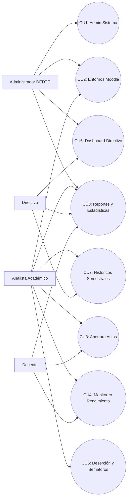
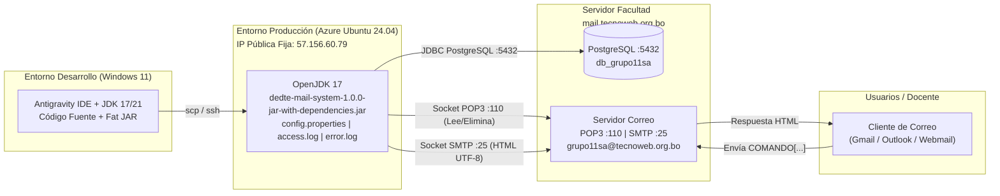
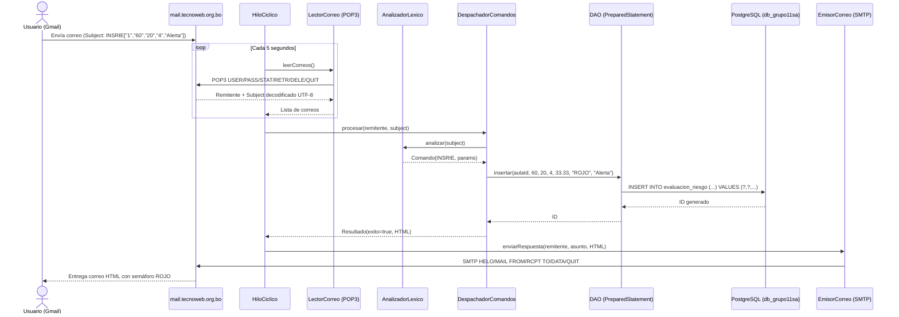
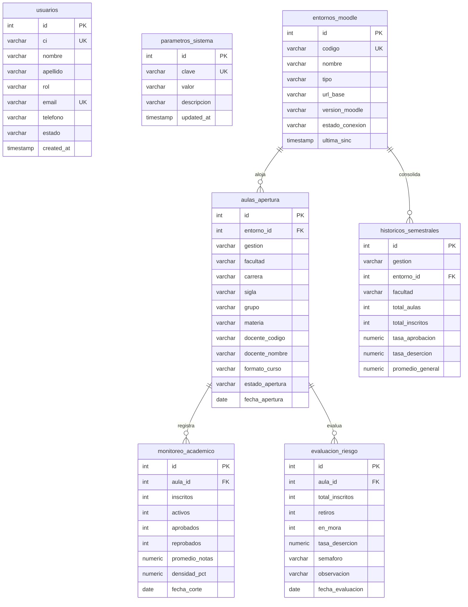

# UNIVERSIDAD AUTÓNOMA GABRIEL RENÉ MORENO
## FACULTAD DE INGENIERÍA EN CIENCIAS DE LA COMPUTACIÓN Y TELECOMUNICACIONES (FICCT)

**Asignatura:** INF513 – Tecnología Web  
**Grupo:** SA — **Grupo #11**  
**Docente:** Ing. Evans Balcázar Veizaga  

---

# DOCUMENTO TÉCNICO (PUDS) — PROYECTO #1
## Sistema de Analítica y Monitoreo Académico DEDTE-UAGRM Basado en Arquitectura Email-Driven

### Integrantes (Grupo #11 SA)
| Registro | Apellidos y Nombres | Carrera |
| :--- | :--- | :--- |
| **221044434** | **Duran Marcelo Kelly Alisson** | Ingeniería en Informática |
| **219198322** | **Quispe Delgado Julio Cesar** | Ingeniería en Informática |

**Correo del Sistema:** `grupo11sa@tecnoweb.org.bo`  
**Base de Datos:** `db_grupo11sa` (PostgreSQL en `mail.tecnoweb.org.bo:5432`)  
**Servidor de Producción (VPS):** Microsoft Azure Ubuntu 24.04 LTS (`57.156.60.79`, región `chilecentral`)  
**Repositorio GitHub:** `https://github.com/<su_cuenta>/inf513-proyecto1`  

**Santa Cruz de la Sierra – Bolivia**  
**Gestión 2-2026**

---

## 1. Perfil del Proyecto

### 1.1 Introducción
La Dirección de Educación a Distancia y Tecnología Educativa (**DEDTE**) de la Universidad Autónoma Gabriel René Moreno (**UAGRM**) administra los entornos virtuales de aprendizaje (**AVA**) basados en **Moodle 5.1** en sus modalidades Virtual, Apoyo Presencial y Capacitación Docente. El seguimiento oportuno de la apertura de aulas, la densidad estudiantil, el rendimiento académico y la deserción requiere herramientas centralizadas, auditables y accesibles desde cualquier lugar.

El presente documento describe el diseño, implementación y despliegue del **Proyecto #1: Sistema de Analítica y Monitoreo Académico DEDTE-UAGRM**, desarrollado bajo una **Arquitectura Email-Driven** en **Java 17**, donde los usuarios interactúan con la base de datos relacional **PostgreSQL** enviando comandos estructurados en el *Asunto (Subject)* de correos electrónicos y recibiendo respuestas automáticas en formato HTML.

### 1.2 Antecedentes
En la gestión académica semestral de la UAGRM, el control de apertura de aulas virtuales, matrícula, retiros, moras y rendimiento académico suele consolidarse manualmente mediante hojas de cálculo dispersas (Excel/ODS) y reportes aislados de cada entorno Moodle. En el marco de la asignatura **INF513 – Tecnología Web**, el Proyecto #1 plantea resolver el dominio de negocio de manera descentralizada mediante protocolos estándar de correo electrónico (**POP3** y **SMTP** sobre sockets TCP/IP) conectados a un motor **PostgreSQL**, sentando además la base de datos compartida que será consumida en el Proyecto #2 (Sistema Web de 3 Capas).

### 1.3 Justificación
* **Técnica:** Demuestra el dominio de protocolos de red a bajo nivel (**POP3** puerto `110` y **SMTP** puerto `25` mediante sockets TCP/IP puros), decodificación MIME UTF-8, análisis léxico-sintáctico estricto (`COMANDO["param1","param2",...]`), consultas preparadas (*Prepared Statements*) contra **PostgreSQL** y registro persistente de auditoría (`access.log`, `error.log`).
* **Académica:** Integra de manera práctica ingeniería de software (PUDS/UML), arquitectura por capas, programación concurrente por hilos y gestión de servidores Linux en la nube.
* **Práctica:** Permite que directivos, analistas y docentes del DEDTE consulten KPIs, registren monitoreos y evalúen semáforos de deserción desde cualquier cliente de correo electrónico (Gmail, Outlook, Zimbra) sin instalar aplicaciones adicionales.

### 1.4 Descripción del Problema
1. **Dispersión de entornos Moodle:** Existencia de múltiples instancias (Virtual, Presencial y Capacitación) sin un registro consolidado de estado y conectividad.
2. **Seguimiento manual de apertura e infraestructura:** Dificultad para auditar rápidamente qué aulas por facultad, carrera, sigla y grupo están aperturadas, pendientes u observadas.
3. **Detección tardía de deserción:** Ausencia de un mecanismo automatizado que calcule la tasa de deserción (retiros y moras) y asigne semáforos de riesgo (`VERDE`, `AMARILLO`, `ROJO`) según umbrales parametrizables.
4. **Falta de comparativas históricas y KPIs ejecutivos:** Carencia de consultas inmediatas para comparar indicadores entre gestiones semestrales (ej. `2025-2` vs `2026-2`).

### 1.5 Objetivos
#### 1.5.1 Objetivo General
Diseñar, implementar y desplegar un sistema backend descentralizado bajo arquitectura **Email-Driven** para la analítica y monitoreo académico de los entornos Moodle del DEDTE-UAGRM, operando sobre **PostgreSQL** y protocolos **POP3/SMTP**.

#### 1.5.2 Objetivos Específicos
* **OE1:** Modelar la base de datos relacional en PostgreSQL (`db_grupo11sa`) cubriendo los 8 casos de uso aprobados y garantizando compatibilidad con el futuro sistema web.
* **OE2:** Implementar un analizador léxico-sintáctico robusto para la gramática `COMANDO["param1","param2",...]` con soporte UTF-8, espacios adicionales y comillas dobles escapadas (`\"`).
* **OE3:** Desarrollar los módulos de negocio y acceso a datos con validación estricta de tipos y uso obligatorio de *Prepared Statements* para prevenir inyección SQL.
* **OE4:** Implementar clientes propios **POP3** y **SMTP** sobre sockets TCP/IP, respuestas HTML institucionales y auditoría local en `access.log` y `error.log`.
* **OE5:** Desplegar el ejecutable `.jar` en un servidor VPS Linux en producción (**Azure Ubuntu 24.04**, IP `57.156.60.79`) y verificar los 8 casos de uso.

### 1.6 Alcance
#### Alcance Funcional (8 Casos de Uso Aprobados)
1. **CU1 — Gestión de Administración del Sistema:** CRUD de usuarios (`ADMIN`, `DIRECTIVO`, `ANALISTA`, `DOCENTE`) y configuración de parámetros/umbrales del sistema (`UMBRAL_RIESGO_AMARILLO`, `UMBRAL_RIESGO_ROJO`, `CAPACIDAD_ESTANDAR_AULA`, `GESTION_ACTUAL`).
2. **CU2 — Gestión de Conexión de Entornos Moodle:** Registro, actualización, eliminación y consulta de entornos (`VIRTUAL`, `PRESENCIAL`, `CAPACITACION`).
3. **CU3 — Gestión de Automatizar Reporte de Apertura e Infraestructura:** Control de aulas aperturadas por gestión, facultad, carrera, sigla, grupo, docente, formato y estado.
4. **CU4 — Gestión de Monitoreo Matrícula, Densidad Estudiantil y Rendimiento Académico:** Registro y consulta de inscritos, activos, aprobados, reprobados, promedio y cálculo automático de densidad porcentual.
5. **CU5 — Gestión de Evaluar Deserción y Asignar Semáforos de Riesgo Académico:** Registro de retiros y moras con cálculo automático de tasa de deserción y asignación dinámica de semáforo (`VERDE`, `AMARILLO`, `ROJO`).
6. **CU6 — Gestión de Explorar Dashboard Directivo e Interactivo en Tiempo Real:** Comando `DASHBOARD` que consolida en una tabla ejecutiva HTML los KPIs globales o por gestión.
7. **CU7 — Gestión de Consultar Históricos Semestrales:** Registro, consulta y comparación intersemestral (`COMPHIS["2025-2","2026-2"]`).
8. **CU8 — Reportes y Estadísticas:** Reportes agregados por facultad (`REPFAC`) y por entorno Moodle (`REPENT`), además de la guía interactiva `HELP["*"]`.

#### Alcance Técnico
* Lenguaje **Java 17** con empaquetado **Maven** (`dedte-mail-system-1.0.0-jar-with-dependencies.jar`).
* Sockets TCP/IP directos para **POP3 (:110)** y **SMTP (:25)**; decodificación MIME con `javax.mail` (`MimeUtility`).
* Persistencia en **PostgreSQL** (`org.postgresql:postgresql:42.7.3`) usando exclusivamente `PreparedStatement`.
* Demonio cíclico (`HiloCiclico`) con sondeo configurable (`config.properties`) y logs persistentes (`access.log`, `error.log`).

#### Limitaciones
* En esta primera entrega la interacción es exclusivamente vía correo electrónico (sin interfaz web gráfica, la cual corresponde al Proyecto #2).
* Las notificaciones son reactivas (respuesta inmediata a cada comando recibido en el buzón `grupo11sa@tecnoweb.org.bo`).

### 1.7 Tecnología para el Desarrollo
* **Entorno de Desarrollo:** Microsoft Windows 11 (64 bits), JDK 21 (`--release 17`), Antigravity IDE, Git y OpenSSH.
* **Entorno de Producción (VPS):** Servidor virtual en **Microsoft Azure** con **Ubuntu Server 24.04 LTS** (`Standard_B2ls_v2`, 2 vCPU, 4 GB RAM, región `chilecentral`, IP pública fija `57.156.60.79`) ejecutando OpenJDK 17.
* **Base de Datos:** PostgreSQL (`db_grupo11sa`) en el servidor institucional `mail.tecnoweb.org.bo:5432` (y PostgreSQL 16 local en el VPS para pruebas integrales).

---

## 2. Marco Teórico e Institución

### 2.1 Protocolos de Correo Electrónico y Sockets TCP/IP
* **Arquitectura Email-Driven:** Patrón asíncrono donde el correo electrónico actúa como bus de transporte de comandos estructurados y canal de retorno de resultados.
* **POP3 (Post Office Protocol v3 — RFC 1939):** Protocolo sobre TCP puerto `110` que permite autenticar (`USER`, `PASS`), consultar cantidad de mensajes (`STAT`), descargar (`RETR`), eliminar mensajes procesados (`DELE`) y cerrar sesión (`QUIT`).
* **SMTP (Simple Mail Transfer Protocol — RFC 5321):** Protocolo sobre TCP puerto `25` utilizado para emitir correos de respuesta (`HELO`, `MAIL FROM`, `RCPT TO`, `DATA`, dot-stuffing y `QUIT`).
* **MIME (RFC 2045):** Estándar que permite codificar cabeceras `Subject` en UTF-8 Base64 (`=?UTF-8?B?...?=`) y enviar cuerpos `Content-Type: text/html; charset=UTF-8`.
* **Sockets TCP/IP:** Interfaz de red de bajo nivel que garantiza entrega ordenada y confiable de los comandos textuales POP3/SMTP terminados en `\r\n`.

### 2.2 Descripción de la Institución (DEDTE — UAGRM)
La **Dirección de Educación a Distancia y Tecnología Educativa (DEDTE)** es la unidad técnica-académica de la UAGRM encargada de gestionar las plataformas de Aulas Virtuales de Aprendizaje (`ava.uagrm.edu.bo`), capacitar a los docentes en el diseño de cursos bajo estándares institucionales y proveer indicadores de rendimiento y retención estudiantil a las autoridades universitarias.

---

## 3. Flujo de Trabajo: Requisitos

### 3.1 Requerimientos Funcionales y No Funcionales
* **RF01–RF02 (CU1):** Registrar, modificar, eliminar y listar usuarios y parámetros globales del sistema.
* **RF03 (CU2):** Administrar el catálogo de entornos Moodle (Virtual, Presencial, Capacitación) y su estado de conexión.
* **RF04 (CU3):** Registrar y consultar reportes de apertura e infraestructura de aulas por facultad, carrera, sigla, grupo y docente.
* **RF05 (CU4):** Registrar y consultar matrícula, estudiantes activos, aprobados, reprobados, promedio y densidad estudiantil.
* **RF06 (CU5):** Evaluar deserción a partir de retiros y moras, asignando automáticamente el semáforo (`VERDE`, `AMARILLO`, `ROJO`) con base en los umbrales de CU1.
* **RF07 (CU6):** Generar un resumen ejecutivo en tiempo real (`DASHBOARD`) con KPIs consolidados.
* **RF08 (CU7):** Consultar y comparar históricos semestrales entre dos gestiones (`COMPHIS`).
* **RF09 (CU8):** Emitir reportes estadísticos agrupados por facultad (`REPFAC`) y por entorno Moodle (`REPENT`), además de la guía `HELP["*"]`.
* **RNF01–RNF05:** Prevención de inyección SQL (*Prepared Statements*), validación estricta de tipos/enums antes de consultar BD, soporte UTF-8 y comillas escapadas `\"`, registro de auditoría en `access.log` / `error.log`, y ejecución continua 24/7 en VPS Linux.

### 3.2 Identificación de Actores
| Actor | Descripción |
| :--- | :--- |
| **Administrador DEDTE (`ADMIN`)** | Configura usuarios, parámetros/umbrales del sistema y entornos Moodle. |
| **Directivo (`DIRECTIVO`)** | Consulta el Dashboard ejecutivo, históricos semestrales y reportes estadísticos. |
| **Analista Académico (`ANALISTA`)** | Registra y audita aperturas de aulas, monitoreo de matrícula y evaluaciones de deserción/riesgo. |
| **Docente (`DOCENTE`)** | Consulta el estado de apertura, rendimiento y riesgo de sus aulas. |

### 3.3 Lista y Prioridad de los 8 Casos de Uso Aprobados
| Orden | Código | Caso de Uso | Prioridad | Comandos Vía Mail |
| :---: | :---: | :--- | :---: | :--- |
| 1° | **CU1** | Gestión de Administración del Sistema (Usuarios, parámetros) | Alta | `LISUSU`, `INSUSU`, `MODUSU`, `DELUSU`, `LISPAR`, `INSPAR`, `MODPAR` |
| 2° | **CU2** | Gestión de Conexión de Entornos Moodle | Alta | `LISENT`, `INSENT`, `MODENT`, `DELENT` |
| 3° | **CU3** | Gestión de Automatizar Reporte de Apertura e Infraestructura | Alta | `LISAPE`, `INSAPE`, `MODAPE`, `DELAPE` |
| 4° | **CU4** | Gestión de Monitoreo Matrícula, Densidad y Rendimiento | Alta | `LISMON`, `INSMON`, `MODMON`, `DELMON` |
| 5° | **CU5** | Gestión de Evaluar Deserción y Semáforos de Riesgo | Alta | `LISRIE`, `INSRIE`, `MODRIE`, `DELRIE` |
| 6° | **CU6** | Gestión de Explorar Dashboard Directivo en Tiempo Real | Media | `DASHBOARD` |
| 7° | **CU7** | Gestión de Consultar Históricos Semestrales | Media | `LISHIS`, `INSHIS`, `COMPHIS` |
| 8° | **CU8** | Reportes y Estadísticas | Media | `REPFAC`, `REPENT`, `HELP` |

### 3.4 Detalle de los 8 Casos de Uso

#### CU1 — Gestión de Administración del Sistema (Usuarios y Parámetros)
* **Propósito:** Administrar los usuarios del sistema y los parámetros/umbrales de negocio vía correo electrónico.
* **Actores:** Administrador DEDTE.
* **Pre-Condición:** Demonio activo y conexión operativa a PostgreSQL (`db_grupo11sa`).
* **Flujo Principal:** 1) El actor envía un correo a `grupo11sa@tecnoweb.org.bo` con `INSUSU`, `MODUSU`, `DELUSU`, `LISUSU`, `INSPAR`, `MODPAR` o `LISPAR`. 2) El analizador léxico valida sintaxis y parámetros. 3) `DespachadorComandos` valida rol, email y tipos, ejecuta `UsuarioDAO` / `ParametroDAO` con *Prepared Statements*. 4) El sistema responde un correo HTML con el resultado y registra la operación en `access.log`.
* **Post-Condición:** Registro persistido o consultado en `usuarios` / `parametros_sistema`.
* **Excepciones:** Sintaxis inválida, CI o email duplicado (`SQLState 23505`), rol inválido o ID inexistente.

#### CU2 — Gestión de Conexión de Entornos Moodle
* **Propósito:** Mantener el registro y estado de conexión de las instancias Moodle de la UAGRM (`VIRTUAL`, `PRESENCIAL`, `CAPACITACION`).
* **Actores:** Administrador DEDTE, Analista.
* **Pre-Condición:** Sistema activo.
* **Flujo Principal:** 1) Envío de `LISENT`, `INSENT`, `MODENT` o `DELENT`. 2) Validación de tipo de entorno y estado (`ACTIVO`, `INACTIVO`, `MANTENIMIENTO`). 3) Ejecución en `EntornoMoodleDAO`. 4) Retorno de tabla o confirmación HTML.
* **Post-Condición:** Entorno actualizado en `entornos_moodle`.
* **Excepciones:** Código duplicado, tipo/estado no permitido o intento de eliminar un entorno con aulas asociadas (`SQLState 23503`).

#### CU3 — Gestión de Automatizar Reporte de Apertura e Infraestructura
* **Propósito:** Registrar y auditar la apertura de aulas virtuales por gestión, facultad, carrera, sigla, grupo, docente y formato de curso.
* **Actores:** Analista, Docente, Directivo.
* **Pre-Condición:** Entorno Moodle (`entorno_id`) previamente registrado en CU2.
* **Flujo Principal:** 1) Envío de `LISAPE`, `INSAPE`, `MODAPE` o `DELAPE`. 2) Validación de estado (`APERTURADA`, `PENDIENTE`, `OBSERVADA`, `CERRADA`) y parámetros obligatorios. 3) Ejecución en `AulaAperturaDAO`. 4) Respuesta HTML.
* **Post-Condición:** Aula registrada/actualizada en `aulas_apertura`.
* **Excepciones:** Clave única repetida `(entorno_id, gestion, sigla, grupo)` o `entorno_id` inexistente.

#### CU4 — Gestión de Monitoreo Matrícula, Densidad Estudiantil y Rendimiento Académico
* **Propósito:** Registrar cortes de matrícula y rendimiento calculando automáticamente la densidad porcentual respecto a `CAPACIDAD_ESTANDAR_AULA`.
* **Actores:** Analista, Directivo.
* **Pre-Condición:** Aula registrada en CU3.
* **Flujo Principal:** 1) Envío de `INSMON`, `MODMON`, `DELMON` o `LISMON`. 2) Validación numérica (`activos <= inscritos`, `0 <= promedio <= 100`). 3) Cálculo de densidad `inscritos * 100 / capacidad`. 4) Persistencia vía `MonitoreoDAO` y respuesta HTML.
* **Post-Condición:** Métricas almacenadas en `monitoreo_academico`.
* **Excepciones:** Valores negativos, activos mayores a inscritos o `aula_id` inexistente.

#### CU5 — Gestión de Evaluar Deserción y Asignar Semáforos de Riesgo Académico
* **Propósito:** Cuantificar deserción (retiros y moras) y clasificar automáticamente el riesgo con semáforo (`VERDE`, `AMARILLO`, `ROJO`).
* **Actores:** Analista, Directivo.
* **Pre-Condición:** Aula registrada en CU3 y umbrales definidos en CU1.
* **Flujo Principal:** 1) Envío de `INSRIE`, `MODRIE`, `DELRIE` o `LISRIE`. 2) Validación (`retiros <= total_inscritos`). 3) Cálculo `tasa = retiros * 100 / total_inscritos` y comparación contra `UMBRAL_RIESGO_AMARILLO` (15%) y `UMBRAL_RIESGO_ROJO` (30%). 4) Persistencia en `EvaluacionRiesgoDAO` y respuesta HTML con insignia de color.
* **Post-Condición:** Evaluación y semáforo registrados en `evaluacion_riesgo`.
* **Excepciones:** Inscritos igual a 0, retiros mayores a inscritos o `aula_id` inexistente.

#### CU6 — Gestión de Explorar Dashboard Directivo e Interactivo en Tiempo Real
* **Propósito:** Entregar a las autoridades un tablero consolidado de KPIs en tiempo real mediante un único comando.
* **Actores:** Directivo, Administrador DEDTE.
* **Pre-Condición:** Datos cargados en `aulas_apertura`, `monitoreo_academico` y `evaluacion_riesgo`.
* **Flujo Principal:** 1) Envío de `DASHBOARD["*"]` o `DASHBOARD["2026-2"]`. 2) `ReporteDAO.dashboardDirectivo()` agrega aulas, inscritos, activos, promedio global, deserción media y conteo por semáforo. 3) Respuesta HTML estructurada.
* **Post-Condición:** Directivo informado en tiempo real sin modificar datos.
* **Excepciones:** Error de sintaxis o fallo de conexión a BD.

#### CU7 — Gestión de Consultar Históricos Semestrales
* **Propósito:** Almacenar, consultar y comparar métricas históricas entre distintas gestiones académicas.
* **Actores:** Directivo, Analista.
* **Pre-Condición:** Entorno Moodle existente.
* **Flujo Principal:** 1) Envío de `LISHIS`, `INSHIS` o `COMPHIS["2025-2","2026-2"]`. 2) `HistoricoDAO` ejecuta consultas preparadas y ordena por facultad y gestión. 3) Respuesta HTML comparativa.
* **Post-Condición:** Históricos consultados o registrados en `historicos_semestrales`.
* **Excepciones:** Porcentajes fuera de rango `[0, 100]` o registro duplicado `(gestion, entorno_id, facultad)`.

#### CU8 — Reportes y Estadísticas
* **Propósito:** Generar reportes agregados por facultad (`REPFAC`) y por entorno Moodle (`REPENT`), además de la ayuda interactiva (`HELP`).
* **Actores:** Directivo, Analista, Administrador DEDTE, Docente.
* **Pre-Condición:** Sistema operativo con datos cargados.
* **Flujo Principal:** 1) Envío de `REPFAC["*"]`, `REPENT["*"]` o `HELP["*"]`. 2) `ReporteDAO` ejecuta agregaciones SQL (`COUNT`, `SUM`, `AVG`, `GROUP BY`). 3) Respuesta HTML tabular.
* **Post-Condición:** Reporte entregado en el buzón del solicitante.
* **Excepciones:** Sintaxis inválida o sin registros para el filtro indicado.

### 3.5 Diagrama General de Casos de Uso


---

## 4. Flujo de Trabajo: Análisis

### 4.1 Análisis de Arquitectura (Paquetes)
El proyecto Java (`bo.tecnoweb.dedte`) se organiza en **5 paquetes desacoplados**:
* `bo.tecnoweb.dedte.config`: `Configuracion` (lectura de `config.properties` / variables de entorno) y `RegistroLog` (`access.log`, `error.log`).
* `bo.tecnoweb.dedte.correo`: `LectorCorreo` (POP3), `EmisorCorreo` (SMTP), `FormateadorHTML` y `HiloCiclico`.
* `bo.tecnoweb.dedte.lexico`: `AnalizadorLexico` y `Comando`.
* `bo.tecnoweb.dedte.negocio`: `DespachadorComandos` (validaciones de dominio, cálculo de densidad y semáforo, enrutamiento de los 8 CUs).
* `bo.tecnoweb.dedte.datos`: `ConexionDB` y 8 DAOs (`UsuarioDAO`, `ParametroDAO`, `EntornoMoodleDAO`, `AulaAperturaDAO`, `MonitoreoDAO`, `EvaluacionRiesgoDAO`, `HistoricoDAO`, `ReporteDAO`).

### 4.2 Flujo del Analizador Léxico (`AnalizadorLexico.java`)
```mermaid
flowchart TD
    A["Asunto entrante (POP3)"] --> B["MimeUtility.decodeText (UTF-8)"]
    B --> C["Eliminar prefijos Re: / Fwd: / Rv:"]
    C --> D{"¿Es HELP / AYUDA?"}
    D -- Sí --> H["Comando HELP[*]"]
    D -- No --> E["Extraer identificador de COMANDO"]
    E --> F{"¿Sigue '['?"}
    F -- No --> ERR["Retornar Comando Error descriptivo"]
    F -- Sí --> G["Bucle de parámetros entre comillas<br/>soportando espacios y \\\" escapadas"]
    G --> I{"¿Cierra con ']' sin texto extra?"}
    I -- No --> ERR
    I -- Sí --> OK["Retornar Comando válido + List&lt;String&gt;"]
```

---

## 5. Flujo de Trabajo: Diseño

### 5.1 Diseño Físico / Diagrama de Despliegue


### 5.2 Diagrama de Secuencia del Procesamiento Email-Driven


---

## 6. Diseño de Datos (PostgreSQL — `db_grupo11sa`)

### 6.1 Modelo Entidad-Relación (MER)


### 6.2 Diccionario de Datos (Diseño Físico)
| Tabla | Clave Primaria | Claves Foráneas / Únicas | Reglas de Integridad (`CHECK`) |
| :--- | :--- | :--- | :--- |
| `usuarios` | `id (SERIAL)` | `ci (UNIQUE)`, `email (UNIQUE)` | `rol IN ('ADMIN','DIRECTIVO','ANALISTA','DOCENTE')`, `estado IN ('ACTIVO','INACTIVO')` |
| `parametros_sistema` | `id (SERIAL)` | `clave (UNIQUE)` | Campos obligatorios `NOT NULL` |
| `entornos_moodle` | `id (SERIAL)` | `codigo (UNIQUE)` | `tipo IN ('VIRTUAL','PRESENCIAL','CAPACITACION')`, `estado_conexion IN ('ACTIVO','INACTIVO','MANTENIMIENTO')` |
| `aulas_apertura` | `id (SERIAL)` | `entorno_id -> entornos_moodle(id)`, `UNIQUE(entorno_id,gestion,sigla,grupo)` | `estado_apertura IN ('APERTURADA','PENDIENTE','OBSERVADA','CERRADA')` |
| `monitoreo_academico` | `id (SERIAL)` | `aula_id -> aulas_apertura(id)` | `inscritos,activos,aprobados,reprobados >= 0`, `promedio_notas BETWEEN 0 AND 100` |
| `evaluacion_riesgo` | `id (SERIAL)` | `aula_id -> aulas_apertura(id)` | `total_inscritos > 0`, `retiros,en_mora >= 0`, `semaforo IN ('VERDE','AMARILLO','ROJO')` |
| `historicos_semestrales` | `id (SERIAL)` | `entorno_id -> entornos_moodle(id)`, `UNIQUE(gestion,entorno_id,facultad)` | `tasa_aprobacion,tasa_desercion,promedio_general BETWEEN 0 AND 100` |

---

## 7. Verificación y Pruebas Ejecutadas en Producción (VPS `57.156.60.79`)

Se ejecutó la batería automatizada `test_8_cus.sh` sobre el servidor Ubuntu 24.04 (`57.156.60.79`) con OpenJDK 17 y PostgreSQL:

| Caso de Prueba | Comando Evaluado | Resultado | Asunto Generado |
| :--- | :--- | :---: | :--- |
| Conexión BD | `--test-db` | **OK** | Conexión JDBC exitosa a `db_grupo11sa` |
| Ayuda | `HELP["*"]` | **OK** | `OK [HELP] - DEDTE Analytics UAGRM` |
| CU1 (Listar/Insertar) | `LISUSU["*"]`, `INSUSU[...]`, `LISPAR["*"]` | **OK** | `OK [LISUSU]` / `OK [INSUSU]` / `OK [LISPAR]` |
| CU2 (Entornos) | `LISENT["*"]` | **OK** | `OK [LISENT] - DEDTE Analytics UAGRM` |
| CU3 (Apertura) | `LISAPE["FICCT"]` | **OK** | `OK [LISAPE] - DEDTE Analytics UAGRM` |
| CU4 (Monitoreo) | `LISMON["*"]`, `INSMON["1","60","56","50","6","78.5"]` | **OK** | Densidad calculada automáticamente (`120.0%`) |
| CU5 (Riesgo) | `LISRIE["*"]`, `INSRIE["2","45","16","5","..."]` | **OK** | Deserción `35.56%` → Semáforo **`ROJO`** |
| CU6 (Dashboard) | `DASHBOARD["2026-2"]` | **OK** | KPIs consolidados en tabla HTML |
| CU7 (Históricos) | `LISHIS["*"]`, `COMPHIS["2025-2","2026-2"]` | **OK** | Comparativa semestral generada |
| CU8 (Reportes) | `REPFAC["*"]`, `REPENT["*"]` | **OK** | Reportes estadísticos generados |
| Validación Sintaxis | `COMANDO_MALO sin comillas` | **OK (Rechazado)** | `ERROR Sintaxis - DEDTE Mail System` |

---

## 8. Conclusiones, Recomendaciones y Bibliografía

### 8.1 Conclusiones
1. Se implementó exitosamente un sistema **Email-Driven** completo en **Java 17** que cubre los **8 Casos de Uso aprobados** del dominio **DEDTE-UAGRM** sobre **PostgreSQL**.
2. La implementación de protocolos **POP3** y **SMTP** mediante sockets TCP/IP, el analizador léxico estricto (`COMANDO["p1","p2"]`), el uso exclusivo de *Prepared Statements* y la auditoría en `access.log` / `error.log` garantizan seguridad, trazabilidad y robustez.
3. El despliegue en un VPS Linux (**Microsoft Azure Ubuntu 24.04**, IP `57.156.60.79`) asegura operación continua 24/7 independiente del equipo de desarrollo.

### 8.2 Recomendaciones
1. Configurar el servicio con `systemd` en el VPS para reinicio automático ante caídas o reinicios del servidor.
2. Reutilizar el esquema PostgreSQL `db_grupo11sa` directamente en el **Proyecto #2 (Laravel + React)** para mantener integridad entre el canal vía correo y la plataforma web.
3. En fases posteriores con la DTIC-UAGRM, integrar la ingesta automática desde Moodle 5.1 mediante Moodle REST Web Services o LTI 1.3.

### 8.3 Bibliografía
* IETF. (1996). *RFC 1939 — Post Office Protocol Version 3 (POP3)*. https://www.rfc-editor.org/rfc/rfc1939
* IETF. (2008). *RFC 5321 — Simple Mail Transfer Protocol (SMTP)*. https://www.rfc-editor.org/rfc/rfc5321
* IETF. (1996). *RFC 2045 — Multipurpose Internet Mail Extensions (MIME)*. https://www.rfc-editor.org/rfc/rfc2045
* Oracle Corporation. (2024). *Java SE 17 & JDBC Database Access Documentation*. https://docs.oracle.com/en/java/javase/17/
* PostgreSQL Global Development Group. (2024). *PostgreSQL 16 Documentation*. https://www.postgresql.org/docs/
* Pressman, R. S., & Maxim, B. R. (2021). *Ingeniería del software: Un enfoque práctico* (9a ed.). McGraw-Hill.
